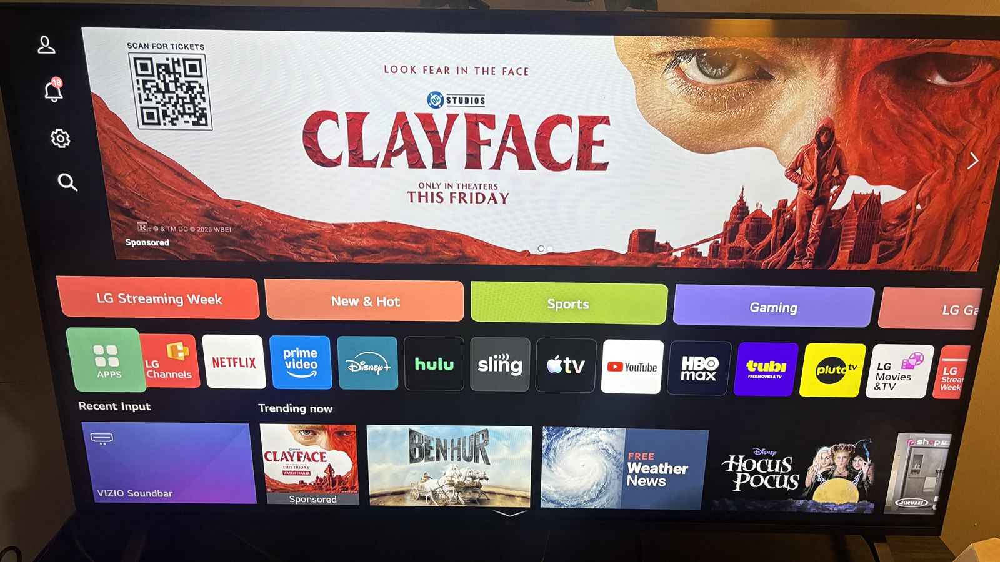
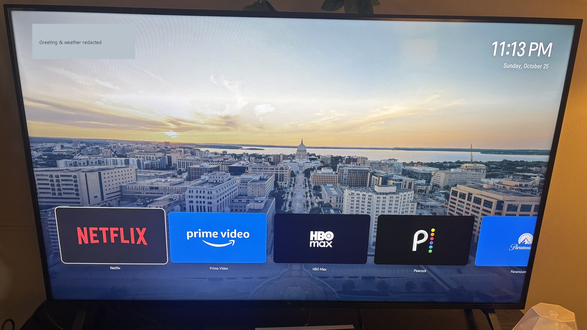
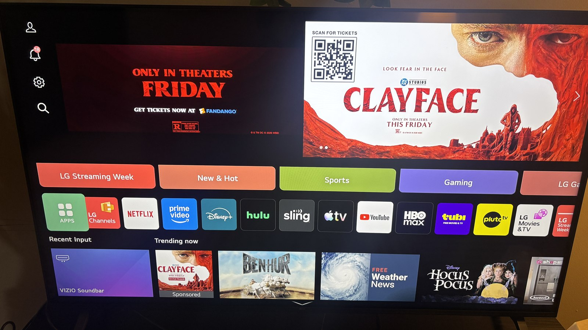
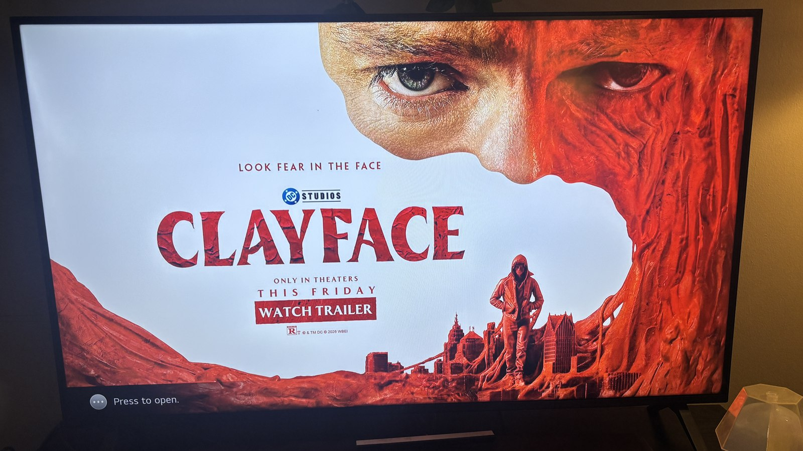

# Reframe

**A calmer, faster home screen for the TV I already owned.**

Turning on my TV meant navigating ads, promotions, and apps I rarely used.
I built Reframe to make that everyday experience simpler: turn it on, choose
an app, and watch something.

| Before | After |
| :---: | :---: |
|  |  |
| Promotions compete with the apps. | The apps become the focus. |

<sub>Photos of the actual TV. Personal greeting and weather location are redacted; camera metadata is removed.</sub>

## What I changed

- **Designed a simpler home screen.** One curated app row, generous spacing,
  recognizable icons, a scenic background, clock, and optional greeting/weather.
- **Made the remote feel better.** Smooth focus movement and deliberate
  press/release handling prevent accidental multi-app skips and repeated launches.
- **Reduced advertising and background work.** Disabled optional promotions,
  content recognition, and unused app preloads after inspecting their behavior.
- **Investigated startup end to end.** Optimized packaged artwork, enabled
  offline startup, and integrated the launcher into the TV's native Home/wake flow.
  Removed the extra loading presentation.
- **Kept the everyday essentials.** Settings, streaming playback, sound, screen
  mirroring, AirPlay, and YouTube casting were checked on the real TV. The original
  home screen remains available through a remote shortcut.

## Measured progress

| Measure | Earlier | Improved |
| --- | ---: | ---: |
| Launcher package | 4.02 MB | **1.56 MB · 61% smaller** |
| Fresh page load, sample runs | 4.15 s | **1.84–2.00 s** |
| Wake handoff | 13.68 s | **2.40 s** |

These are local measurements on one TV. Wake handoff measures the native startup
cover opening to the launcher reaching the foreground; a full restart still
takes about 36 seconds. [Measurement details and limits →](docs/PERFORMANCE.md)

## Built with

**TypeScript · Vite · CSS · webOS service APIs**

The launcher uses no UI framework. Artwork is packaged locally, weather loads
asynchronously, and the app works without waiting for a network connection.
The project combines interface design, remote-input handling, performance
profiling, and careful integration with an existing device.

## Try the interface

```sh
npm ci
npm run dev
```

Open `http://127.0.0.1:5173`. Use arrow keys and Enter; app launches are simulated
in a desktop browser. `npm test` runs the bridge tests, and `npm run build`
produces the packaged web assets.

[Architecture](docs/ARCHITECTURE.md) · [Development and customization](docs/DEVELOPMENT.md) · [Artwork credits](public/backgrounds/ATTRIBUTION.md)

<details>
<summary>More of the original experience</summary>

The same home screen also devoted space to promotional panels and full-screen
advertising. These additional photos show what motivated the redesign.





</details>
