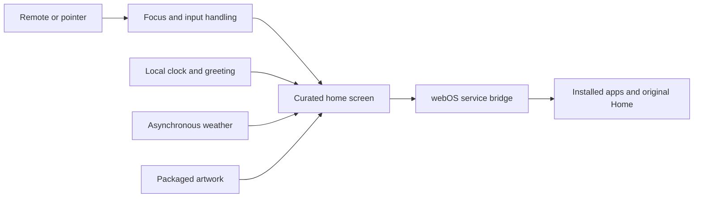

# How Reframe works

Reframe is a small web application packaged for an LG webOS TV. Its interface
is written in TypeScript and CSS, with Vite handling development and bundling.

## Interface

The home screen has one horizontally scrolling app row. Large targets,
visible focus, and a short animation make navigation clear from across a room.
The clock, greeting, and weather stay separate from the primary task of opening
an app. There are no recommendations, tracking scripts, or advertising SDKs in
the launcher.

## Input and app launching

`src/core/focus.ts` handles remote presses, repeats, releases, scrolling, and
pointer movement. It prevents a held button or small pointer jitter from causing
unexpected selections. `src/core/luna.ts` wraps the native service bridge with
timeouts, response validation, and request cleanup. Native failures remain
visible; desktop previews simulate successful launches without a TV connection.

`src/launcher/` renders the cards. The explicit original-Home shortcut lives in
`src/core/home-escape.ts`, providing an escape from the custom launcher.

## Performance decisions

Artwork is bundled locally. The wallpaper is cropped to its displayed area and
compressed before packaging. Weather is optional and asynchronous, so it cannot
block the launcher. The package declares offline startup and Quick Start support.
The UI uses transform-based focus motion and no application framework.

The on-device work also examined startup sequencing, running processes,
proportional memory use, and preload policy. Optional advertising features and
unnecessary preloads were disabled with saved original settings. Playback,
audio, input, casting, and recovery dependencies were preserved.

## Repository layout

| Path | Purpose |
| --- | --- |
| `src/core/` | Configuration, focus, service bridge, and remote shortcuts |
| `src/launcher/` | App cards and launch feedback |
| `src/widgets/` | Clock, greeting, and weather |
| `public/` | webOS app metadata, bundled wallpaper, and app artwork |
| `scripts/` | Portable browser checks and asset preparation |
| `tests/` | Service-bridge behavior and failure handling |

The public repository contains the launcher and a sanitized project case study.
Personal device configuration, session notes, connection material, backups, and
device-specific maintenance tools are kept outside the tracked public files.
