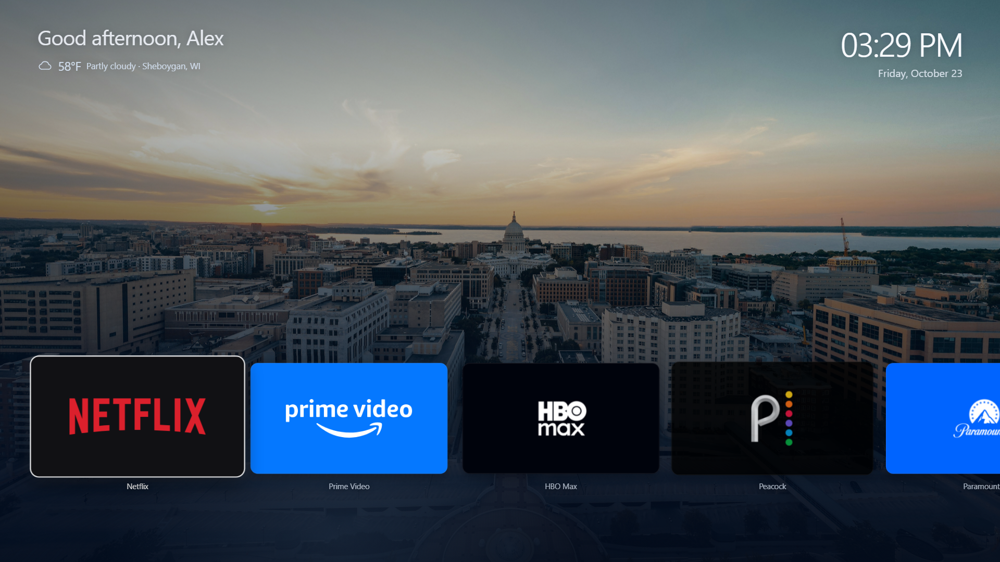
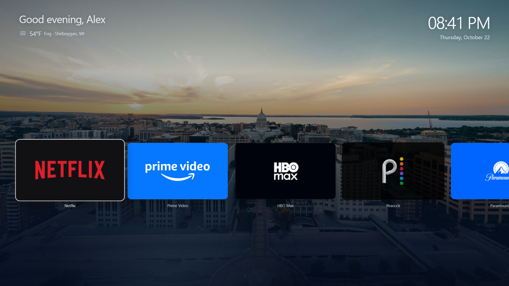
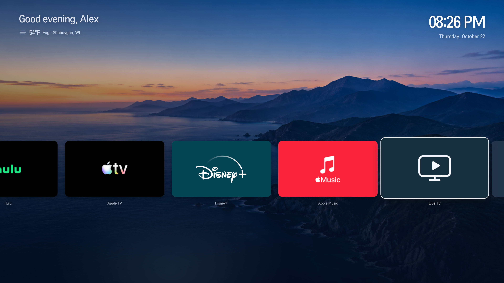
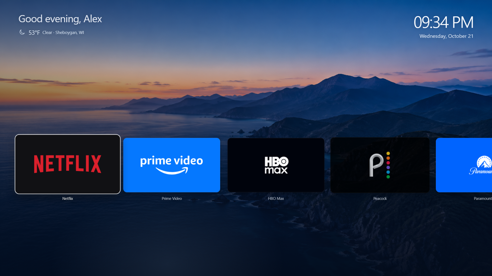
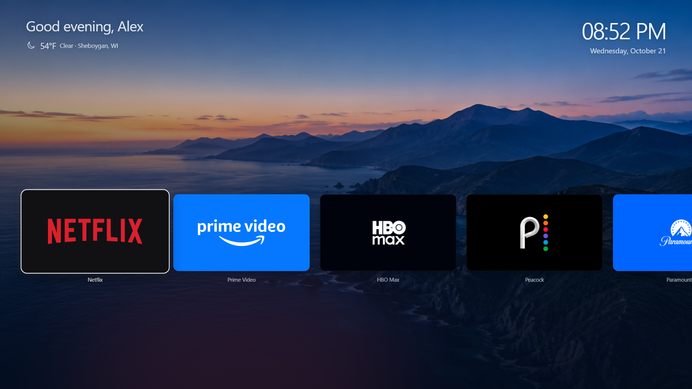

# Reframe 0.3.9: personal startup

Alex's original portfolio AH SVG now draws on the original deep green canvas
and fades into the same Madison home screen. [Source, checks and native-screen
limitations](PERSONAL-STARTUP.md). Existing app row/header remain.

# Reframe 0.3.8: more room for Madison

The app row sits lower, exposing more of the Capitol and cityscape. Tile size,
photo, header and navigation are retained. The focused tile starts at 64.4% of
the actual 2160p TV canvas. Reframe also has an explicit Blue-button escape to
LG Home and metadata disabling its launch spinner/splash. Native install passed
all 46 file hashes; browser checks include lower-row bounds and the Blue target.
See [NATIVE-STARTUP.md](NATIVE-STARTUP.md) for startup/Home integration results.

## Earlier 0.3.6 wallpaper

The background is now a real Madison aerial with the Capitol dome and Lake
Mendota at sunset. The approved app row, Live TV icon, header and navigation
remain. The crop keeps the Capitol above the cards. All 46 native installed
file hashes matched; browser/build/package checks pass. Source/license and
preview: [MADISON-BACKGROUND.md](MADISON-BACKGROUND.md).

## Earlier 0.3.5 Live TV icon

Live TV now uses an original white TV/play symbol on muted navy, replacing the
IPTV player's busy logo. The approved layout and navigation are unchanged.
Build and browser checks pass at 1080p/4K; the native installation passed all
44 file hashes and foreground verification. The player now has ten Favorites
plus a searchable US catalog; see [remote instructions](IPTV-REMOTE-GUIDE.md).

## Earlier 0.3.4 Live TV tile

The owner authorized a native IPTV player trial. This version retains the
approved scene, header, nine favorites and navigation tuning, and adds one
Live TV tile immediately before More Apps. It launches com.lennylxx.iptv and
the TV-resident curated channel list. No Settings/input rows are restored.
Browser checks pass for eleven tiles, twelve images, navigation and 1080p/4K
layout. The TV installation passed all 43 file hashes and foreground checks.
Actual D-pad/OK activation of Live TV opened the saved ten-channel guide.
See [IPTV-TRIAL.md](IPTV-TRIAL.md) for native playback results.

## Earlier 0.3.2 layout

This layout is retained in 0.3.3 with lighter focus rendering and deliberate
remote repeat handling; see [REMOTE-NAVIGATION.md](REMOTE-NAVIGATION.md).

The owner accepted the simpler app row and requested a final small cleanup.
The changing selected-app heading, Reframe branding and all footer text
(position count, Browse/Open and Home) are removed. The greeting, time and date
are larger. The scenic background and exact ten-card row remain unchanged.

Weather now uses Sheboygan, Wisconsin city coordinates (43.75083, -87.71453),
resolved with the [Open-Meteo geocoding API](https://open-meteo.com/en/docs/geocoding-api).
[Open-Meteo current conditions](https://open-meteo.com/en/docs) provide Fahrenheit
temperature, condition and day/night. Simple bundled SVG symbols avoid emoji
font differences on the TV. Weather refreshes every 15 minutes while visible,
on returning after that interval, and when connectivity returns after a failure.
Requests time out after 10 seconds. A failed or invalid response displays
Weather unavailable with the city, and clears the temperature rather than
showing stale or invented conditions. Weather never blocks app navigation.

The local Chromium check passed with live Sheboygan weather, exact ten-card
order, navigation/reveal tests and 1080p/4K layout. It also verifies removal of
the headings/branding/footer, larger header sizes, weather validation, network
failure and reconnect behavior. This check now needs internet for live weather;
it never contacts the TV. The screenshot contains the live response at capture
time, not a fixed production temperature.

Reframe 0.3.2 is installed and foreground on the TV. Native install/launch
passed, all 41 installed file hashes matched the package and the exact owned
upload stage was removed. The previous local 0.3.1 IPK was preserved privately.
Source checkpoint `827fde8` is pushed. Live weather was verified in the local
browser; owner TV weather/visual/remote acceptance is pending. Root/boot/wake,
native launch/Back behavior and the deferred app-exit/startup routing tasks
are unchanged.

## Previous 0.3.1 checkpoint

The owner selected exactly nine apps, in this order: Netflix, Prime Video,
HBO Max, Peacock, Paramount+, Hulu, Apple TV, Disney+ and Apple Music.
They occupy one horizontal row of large cards (384 px wide at 1080p), followed
by a matching **More Apps** card. More Apps launches the native LG App Store
(`com.webos.app.discovery`); it is not another Reframe library page.

The scenic background is retained unchanged. Settings, inputs and all other
app tiles have been removed from Home. Existing apps remain installed on the
TV. Remote Settings/Back and native app launch behavior are unchanged.
The generated background's original prompt and provenance remain in
[LIBRARY-REFRESH.md](LIBRARY-REFRESH.md); that document describes the superseded
32-app candidate view.

Validation: TypeScript/Vite production build and the local Chromium UI check
passed. The browser check verifies exact app order, ten cards in one row,
all eleven images loaded, large card sizing, horizontal boundaries/reveals,
rapid direction reversal, pointer/remote focus, held OK activating once,
More Apps dispatching the native store ID, and 4K layout without page overflow.
Browser-check profiles are excluded from Vite's watcher to prevent extension
HTML from reloading the preview during navigation tests.

Reframe 0.3.1 is installed and foreground on the TV. Native install/launch
succeeded, all 41 installed file hashes matched the package, and the owned
upload stage was removed. The previous local 0.3.0 IPK was preserved privately.
Source checkpoint: `b52b266` (pushed). Owner visual/remote acceptance is pending.
App/cast return routing and startup screen transitions remain separate deferred
tasks. No new owner playback/casting acceptance result is claimed by these
browser and installation checks.
