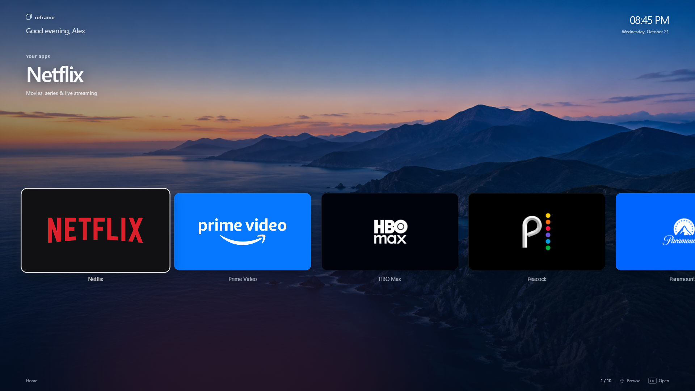

# Reframe 0.3.1: a simpler Home

The owner selected exactly nine apps, in this order: Netflix, Prime Video,
HBO Max, Peacock, Paramount+, Hulu, Apple TV, Disney+ and Apple Music.
They occupy one horizontal row of large cards (384 px wide at 1080p), followed
by a matching **More Apps** card. More Apps launches the native LG App Store
(`com.webos.app.discovery`); it is not another Reframe library page.

The scenic background is retained unchanged. Settings, inputs and all other
app tiles have been removed from Home. Existing apps remain installed on the
TV. Remote Settings/Back and native app launch behavior are unchanged.
The generated background's original prompt and provenance remain in
[LIBRARY-REFRESH.md](LIBRARY-REFRESH.md); that document describes the superseded
32-app candidate view.

Validation: TypeScript/Vite production build and the local Chromium UI check
passed. The browser check verifies exact app order, ten cards in one row,
all eleven images loaded, large card sizing, horizontal boundaries/reveals,
rapid direction reversal, pointer/remote focus, held OK activating once,
More Apps dispatching the native store ID, and 4K layout without page overflow.
Browser-check profiles are excluded from Vite's watcher to prevent extension
HTML from reloading the preview during navigation tests.

Reframe 0.3.1 is installed and foreground on the TV. Native install/launch
succeeded, all 41 installed file hashes matched the package, and the owned
upload stage was removed. The previous local 0.3.0 IPK was preserved privately.
Source checkpoint: `b52b266` (pushed). Owner visual/remote acceptance is pending.
App/cast return routing and startup screen transitions remain separate deferred
tasks. No new owner playback/casting acceptance result is claimed by these
browser and installation checks.
