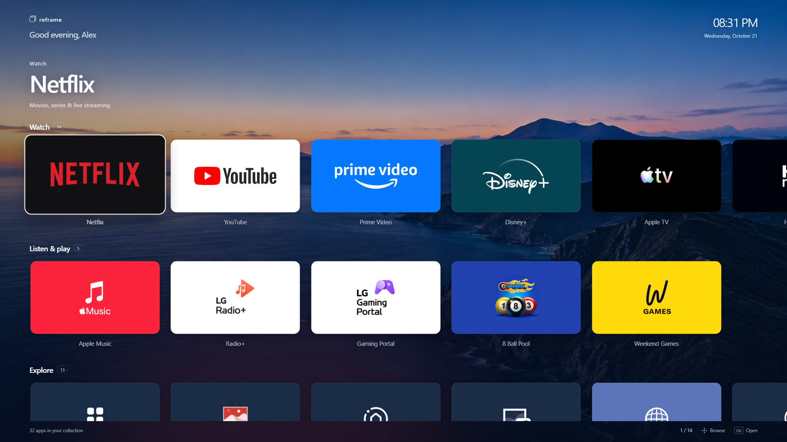
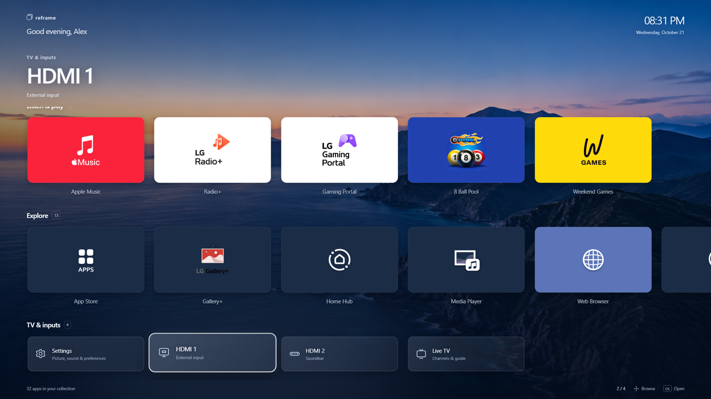

# Reframe 0.3.0: scenic home and full app collection

The owner requested a richer Apple TV-like feel, smoother movement between
apps, and many more apps before deciding which belong on Home versus More Apps.
This version exposes 32 installed apps across horizontal shelves. No Home/More
Apps choices have been made on the owner's behalf.

## App candidates

| Shelf | Installed apps shown |
| --- | --- |
| Watch | Netflix, YouTube, Prime Video, Disney+, Apple TV, HBO Max, Hulu, Paramount+, Peacock, Tubi, Pluto TV, Sling TV, LG Channels, LG Movies & TV |
| Listen & play | Apple Music, LG Radio+, LG Gaming Portal, 8 Ball Pool, Weekend Games |
| Explore | App Store, LG Gallery+, Home Hub, Media Player, Web Browser, Sports, LG Sports Playbook, Amazon Alexa, Copilot, Camera, LG Travel+, ShopTime, Homebrew Channel |
| TV & inputs | Settings, HDMI 1, HDMI 2 (Soundbar), Live TV |

The 32 app IDs and icon paths came from the actual TV's current visible-app
inventory. Reframe itself and a temporary streaming promotion were excluded.
Hidden internal services/overlays were not exposed. No new third-party apps
were installed. Existing vector wordmarks remain for four streaming apps;
28 additional public app icons are bundled from their installed packages.

## Interaction and visual changes

- A locally bundled blue-hour coastal landscape replaces the flat gray canvas.
  Readability comes from layered blue scrims and a restrained focus-colored glow.
- A selected-app title, shelf counts and position indicator clarify navigation.
  Five large cards and a hint of the next card fit across a 1080p view.
- Left/right follows shelf order; up/down remembers the last selection in each
  shelf, with a visible-column fallback on the first visit.
- Horizontal/vertical reveals run independently with cancellable 220 ms easing.
  A pending scroll destination is considered during direction reversals so an
  old animation cannot carry the selected button out of view.
- Pointer movement and remote/native button focus stay synchronized. Scrolling
  under a stationary pointer does not steal remote focus. Native button focus
  uses roving tab stops and `preventScroll` rather than moving every ancestor.
- Held OK activates once, while held arrows are paced. Reduced-motion users
  receive immediate scrolling and disabled CSS transitions. Back stays native.

`scripts/check-ui.mjs` runs against a local `npm run dev` preview, using a hidden
Chromium browser and no TV connection. It checks all 36 buttons/33 images,
horizontal boundaries, row memory, pointer/remote synchronization, held OK,
scroll reveals, rapid reversals, and 1080p/4K viewport overflow. Run with
`--capture` to update the screenshots above. Set `REFRAME_BROWSER` if Chromium
is installed outside the detected locations. Other runs save images under
ignored `.research/`.

Production build and existing 77 Node/12 Python tests passed. Live installation
results and owner feedback are recorded in HANDOFF.md. The root, boot/wake,
native app-launch bridge and deferred return/startup routing were not modified.

## Background asset and generation prompt

Saved asset: `public/backgrounds/coast-blue-hour.png` (1672 x 941 PNG, scaled to
the viewport). Generated with the **built-in imagegen tool**, using the imagegen
skill; no CLI/API-key fallback was used. The tool returned this resolution even
though the prompt requested 4K if available. Original generation remains in the
tool's generated-image directory; the project has its own bundled copy.

Final prompt:

> Use case: photorealistic-natural. Asset type: wide 16:9 4K background photograph for a premium smart-TV home screen. Create a cinematic high-altitude aerial view of a quiet mountainous coastline at blue hour: deep cobalt ocean in the foreground, a sculptural dark coastal ridge sweeping diagonally from lower right toward the middle, distant indigo mountains dissolving into atmospheric haze, soft pale blue sky with a slender band of warm peach at the horizon. Serene, luminous, immersive, refined natural photography, realistic terrain and water, subtle fine detail, gentle tonal separation. Wide composition with generous calm sky and open ocean; the upper left must stay uncluttered for white greeting text, lower half dark enough behind TV app cards. Sophisticated midnight blue, slate, sea teal and a restrained apricot horizon, no gray wash and no neon. Keep the landscape beautiful as a real full-screen wallpaper, not an interface mockup. No text, no logos, no icons, no borders, no buildings, no people. Output landscape 3840x2160 if possible.
