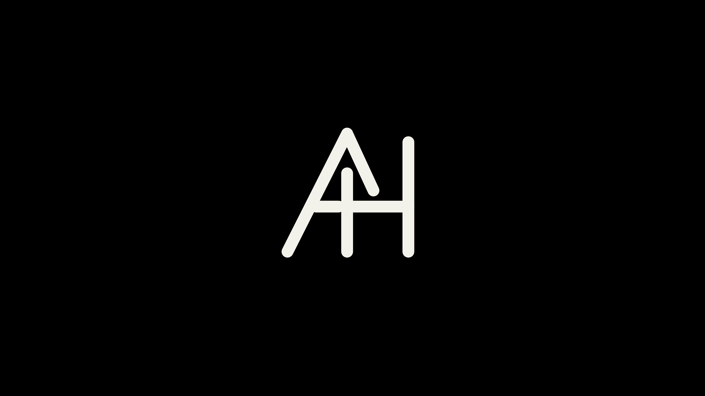

# Alex's portfolio startup animation

**Current 2026-10-25 - owner accepted Reframe 0.3.13 speed and compatibility.**
The owner confirmed the real remote off / wait about 10 seconds / on sequence
is notably faster, with AH drawing on black then Madison working correctly.
Home/Blue/Settings/Back, Prime playback/exit and iPhone Screen Mirroring,
AirPlay and YouTube Cast all passed. No checks remain pending for this package.

The passive bootd recording supports the improvement: cover-open to Reframe's
foreground report was about 13.68 seconds on the earlier wake, versus 2.32
seconds on the new one. These are the same native event interval, not the
entire remote-button-to-picture time. The effects of Quick Start, offline
metadata, lighter artwork and preload changes were not isolated individually.
One full restart with 0.3.12 still took about 35.8 seconds to compositor-visible
Reframe (previously 36.5); do not claim a large cold-boot improvement.

The package is about 61% smaller. Fresh-document load measured 4.15 seconds
before versus 1.84-2.00 seconds after. The three optional LG Channels/browser/
voice preload exclusions survived restart; those apps were absent from the
running list. Live undo/reapply passed. No apps/services were removed, and the
accepted native cover, firmware hosts, root and Home/return routing are intact.
92 Node / 45 Python tests and desktop 1080p/4K checks passed. Preserve
backups/preloads/current.json and both UI deployment backups. Read
[STARTUP-PERFORMANCE.md](STARTUP-PERFORMANCE.md) for measurements and exact undo.

The Packers search found WITI/Fox Milwaukee's free news feed, not a verified
free NFL stream. FOX6 explicitly excludes NFL from FOX LOCAL. The owner has
neither an antenna nor subscription. No channel/Favorite was added, no extra
channels played and no paid service/trial started. Read
[PACKERS-LOCAL-TV.md](PACKERS-LOCAL-TV.md). The earlier accepted 0.3.11 native
startup checkpoint below remains available as the rollback baseline.

**Earlier accepted 0.3.11 baseline - startup animation, popup suppression and compatibility.**
After a real remote off / wait about 10 seconds / on, the owner confirmed the
full AH monogram draws on pure black and fades into Madison, with no Reframe
Loading words or default spinner. No firmware or Alexa popup appeared during
that use. Home/Blue/Settings/Back, Prime Video playback and exit to Reframe,
iPhone Screen Mirroring, AirPlay and YouTube Cast all passed; ordinary app/cast
exits do not replay the intro. This is the accepted baseline, not a pending test.

Reframe remains 0.3.11. The approved early native resource is active and readonly;
the old late compositor environment override remains disabled. A full restart
previously returned pinned root SSH at uptime 46.68 seconds with a fresh HBC
callback; all 60 staged files verified. The guarded trial was accepted and only
its own trial Activity cancelled. No signed firmware, bootloader, kernel or
saved snapshot image was changed. Preserve the private early-cover journal,
remote ownership plan, image and original resource DB backup.

The four firmware-server names map to loopback. LG app-store DNS and app-update
mode/services are preserved; no app/firmware update was installed. The owner
observed no reminders in the acceptance use; this does not promise every future
notification source is suppressed.

The completed logo still holds for several seconds while startup finishes.
The owner prefers a measured speed improvement, with a subtle Loading fallback
acceptable if necessary. Read-only investigation found app launch-to-visible
latency around 8.28 seconds on the recorded restart and 10.81 seconds on the
recorded wake. Optional cold-boot preloads started later, so deleting apps is
not established as a fix. Investigate offline-start metadata and image decoding
before any system service changes. No performance change has been deployed.
See [STARTUP-PERFORMANCE.md](STARTUP-PERFORMANCE.md) for evidence and next steps.

All 92 Node and 42 Python tests passed at the installed checkpoint. Current
read-only investigation changed no TV settings, services, files or app state.
Installed method, undo and guard limits: [EARLY-COVER-TRIAL.md](EARLY-COVER-TRIAL.md).

Earlier checkpoints below are historical.

**Current 2026-10-25 - native AH cover installed and verified on TV.**
The owner explicitly approved the private CoverUI import override and guarded
UI restart. Reframe 0.3.11 is installed (47 file hashes verified), and the obsolete
app observer permission was removed. The compositor loads our private module;
all 57 module files match their journal. Actual 1920x1080 compositor captures
show partial AH strokes, the completed cream monogram on pure black, then an
automatic fade into Madison, with Reframe foreground. No Reframe Loading text
appears in the native test. The final guarded trial was accepted while enabled.
Two earlier unconfirmed trials rolled back safely; the first capture attempt
also ran before app surfaces recovered. No firmware files changed.

Owner standby/wake and controls/app-return/popup checks are now pending.
**Make no TV launch, recovery, restart or power requests during those checks.**
A fresh full boot with this cover has not yet been tested. Root SSH stayed
available through the UI restarts. The prior Home/Blue/Settings and app/cast-exit
routing are preserved. Reverse shutdown animation remains deferred.

Firmware checks remain disabled (softwareUpdateEnable string false), firmware
automaticUpdate remains off, and the Alexa guide is marked seen. App update mode
is still manual, unchanged. Those settings persisted since October 23; actual
popup suppression still needs owner observation. Preserve both private rollback
journals. See [NATIVE-COVER-TRIAL.md](NATIVE-COVER-TRIAL.md) for evidence and undo.

The earlier app-level implementation below is historical; it was removed in 0.3.11.

Current follow-up: the owner reports 0.3.10's wake intro still failed. A native
CoverUI replacement is prepared, with an exact-action approval gate before
installation. See [NATIVE-COVER-TRIAL.md](NATIVE-COVER-TRIAL.md). 0.3.11 is local
only; the TV remains on 0.3.10. The preceding TV animation claims were not
owner acceptance.


Reframe 0.3.9 bundles Alex Holland's original AH hero SVG from
[his portfolio source](https://github.com/alexholland4/alexholland4.github.io/tree/66c1dec6b1585652681086a618bb6019f33a442e),
at commit `66c1dec6b1585652681086a618bb6019f33a442e`.
Alex explicitly requested extracting and using his own artwork here.

The SVG in `index.html` preserves the six line coordinates, normalized path
lengths, 22-unit rounded strokes, and dormant arrow/pop elements. It keeps the
normal hero's cream ink (`#F3F2EA`), easing `cubic-bezier(.22,1,.36,1)`, 350 ms
initial delay, 170 ms staggering and 620 ms draw duration. The final stroke
finishes 1.82 seconds after playback starts. The portfolio's optional company
personalization overlay is separate and is not the reference. The owner later
requested a pure black background; 0.3.10 uses `#000` rather than portfolio green.

## Actual TV diagnosis and 0.3.10 correction

The owner saw no mark on wake and partial static strokes on app returns with
0.3.9, despite the desktop checks. Read-only native CoverUI inspection found
500 ms loading-text fade followed by 1,500 ms background fade. The old intro
started its clock at page creation, spending most/all of its draw behind that
cover. Its absolute three-second dismissal could truncate visible playback.

Actual TV replay measurements also identified the large SVG drop shadow as a
rendering cost: 34 frames / 1.94 seconds (about 18 fps) with the shadow, versus
84 / 1.90 seconds (about 44 fps) without it. An actual TV intermediate screenshot
confirmed the SVG paints correctly without the filter. This is not evidence of
exhausted memory. The filter is removed in 0.3.10.

`src/core/startup.ts` now subscribes to native `getForegroundWindowInfo`:

- Presence of `com.webos.app.cpcover` arms a startup/wake sequence, with drawing
  paused. Ordinary app returns without this cover leave the intro hidden.
- When the cover disappears, wait for visible app state, local artwork decoding
  and two animation frames, then begin the original six-stroke draw.
- Completion of the actual final stroke starts a 280 ms hold, then a 450 ms
  fade. An eight-second failure guard replaces the absolute normal clock.
- Input dismisses immediately and still reaches the normal UI control handler.
  Hidden/visible notifications, queued readiness work and reduced motion are
  handled without restarting after cancellation. No launch/power calls occur.
- A later native cover appearance can rearm the same retained webview on wake.

The markup starts hidden, so unavailable/denied status leaves Home usable.
All artwork/code is bundled; weather/network availability does not gate drawing.
Native status and decoded artwork gate playback, rather than guessing a delay.



## Read-only visibility permission and rollback

The generated dev-app profile originally grants `public` only; appinfo
`requiredACG` alone does not give this TV's dev-installed app native window
status. The initial separate custom one-method policy did not yield access and
was removed. The working controller adds the existing **read-only**
`surfaces.status` group only to `com.reframe.home-*`. It grants window/surface
queries, with no app launch, input, power or root control. The app uses only
`getForegroundWindowInfo` with a subscription.

```powershell
python scripts/manage-startup-visibility.py install --execute
python scripts/manage-startup-visibility.py status
python scripts/manage-startup-visibility.py remove --execute
```

This controller snapshots the exact original public-only profile bytes/mode
before writes, in `/var/lib/reframe/visibility-plan.json`. It owns just its new
manifest under `/var/luna-service2/manifests.d` and the added group in Reframe's
own generated `/var/luna-service2-dev/client-permissions.d` file. Hash/ownership
checks refuse foreign modifications. Removal restores original bytes/mode and
removes only its own manifest/journal. Root SSH/HBC/native Home/return policy
are independent. Reopen only Reframe after changing permissions: the TV caches
permission groups on an existing app bridge connection. Actual fresh-app
status access succeeded; simply creating another bridge in the old process
did not refresh the grant.

App installs regenerate that profile. `deploy-root.py` now reapplies the
hash-verified managed opt-in after installation and before launching, then
closes only Reframe via the SDK's `dev/closeByAppId` endpoint to refresh cached
connections. It does nothing if the observer plan is absent. This integration
has local regression tests; its first full live deployment is still pending.
The known manual close/reopen via Reframe's normal `window.close()` succeeded.

## Native screen boundary

Read-only inspection located the earlier “Reframe Loading” text in LG's native
CoverUI `UserInterfaceLayer/Containers/MainView.qml`. It displays the launching
app title plus a localized Loading string before the app renders. This is
separate from the app splash and spinner already disabled in Reframe metadata.
The inspected component exposes no app-specific animated-SVG splash field.
The app intro alone does not establish replacement of this earliest native UI.
The owner confirmed these native words remain before the 0.3.9 app intro.
The 0.3.10 timing fix waits for this cover to close; it does not remove it.

The reverse shutdown animation is deferred. LG has separate native logo and
compositor assets; a page visibility event neither identifies power-off reliably
nor guarantees time to render before the panel goes dark. No shutdown hook,
system QML, logo asset, firmware, boot partition or power sequencing was changed.
A later investigation can examine a reversible native customization; do not
delay or intercept shutdown merely to replay a web animation.

## Validation and undo

- Production build, all 82 Node and 31 Python tests pass. New policy tests cover
  exact original-byte restoration, journal-before-write, foreign file/symlink
  refusal and repair after an app reinstall. Deployment tests ensure only
  Reframe can be closed and the managed opt-in is refreshed first.
- Browser checks hold a simulated native cover open for 2.3 seconds (longer than
  the whole draw), verifying no strokes advance. After release, they verify
  progressive drawing, the complete final frame held before fade, ordinary app
  return skipping, a second cover/wake, remote cancellation races, reduced
  motion and observer-denial fallback. Existing UI/navigation/weather checks
  at 1080p/4K pass.
- Root deployment verified all 47 installed files and Reframe foreground.
  Actual TV inspection confirmed pure black and successful native window
  status access after reopening Reframe. Original shadow A/B timing and a real
  SVG intermediate screenshot are retained under ignored research.
- Owner confirmed Prime Video exit and Screen Mirroring disconnect return to
  Reframe. 0.3.10 wake/full-animation and no-intro-on-Prime-exit retests have
  been requested. No TV launch/recovery/reboot/power actions during those checks.

To remove the intro, remove its overlay and stylesheet link from `index.html`
and the `mountStartup` import/call from `src/main.ts`, then rebuild/deploy with
the guarded installer. Remove its read-only observer separately with the
controller above and reopen Reframe. The previous app package is retained
locally in ignored backups. Native startup/Home/app-exit settings are independent.
