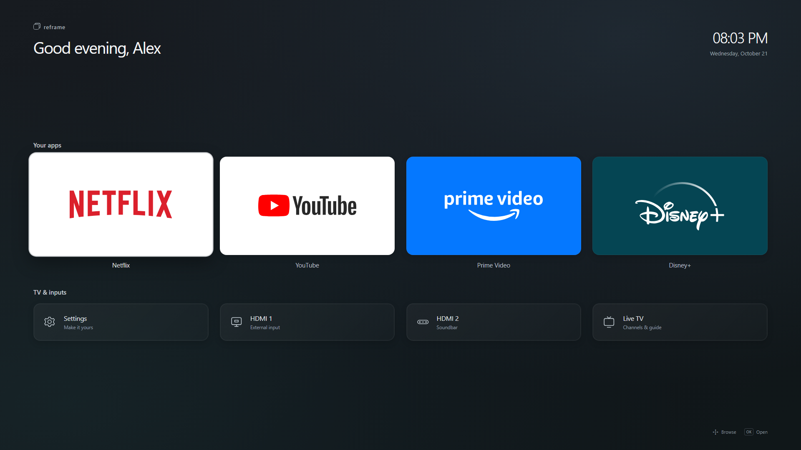

# Reframe 0.2.0 visual refresh

The owner requested actual app icons and a simple, spacious Apple TV-inspired
appearance. This refresh uses large rounded 16:9 branded app cards, a quieter
row for TV/input controls, restrained charcoal/teal gradients, lighter type,
more negative space, and a raised white remote-focus outline.

Netflix, YouTube, Prime Video and Disney+ use bundled SVG wordmarks for sharp
4K rendering without runtime icon downloads. Sources/credits are in
`public/icons/README.md`. Settings, HDMI, soundbar and TV have consistent
line icons. HDMI 2 is labeled as the owner's soundbar. Weather stays hidden
until a real location is configured, instead of showing placeholder coordinates.

The native launch bridge, app IDs, remote Back and existing root/boot/wake
configuration are unchanged. App/cast exit routing and the brief native startup
screen remain the separately deferred tasks in NEXT-SESSION.md.

TypeScript/Vite production build and packaging pass. A hidden browser verified
all four images, eight buttons, no overflow at 1920x1080 and 3840x2160, and
Right/Down/Left/Up remote navigation across both rows. The existing 77 Node
checks pass. Root deployment is prepared separately; current live result is
recorded in HANDOFF.md.

`python scripts/deploy-root.py com.reframe.home_0.2.0_all.ipk --execute` uses the
existing strict root SSH pin/key, validates the app-only IPK and metadata,
preserves the previous local package under ignored backups, uploads to a unique
protected temporary stage, requests one native install, verifies every installed
app-file hash and version, launches Reframe, and removes only its validated
stage. Without `--execute` it inspects the local package without TV access.
It does not require reinstating LG Developer Mode or enabling TCP forwarding.
